<p align="center">
  
</p>

<p align="center">
  <a href="https://milindev.com/"></a>
  <a href="https://www.linkedin.com/in/milindkeni"></a>
  <a href="https://x.com/Mtweet7002"></a>
  
</p>

<p align="center">
  
</p>

<br>


```kotlin
object Milind : Engineer {
    override val role       = "Senior Software Engineer @ WebEngage"
    override val base       = "Mumbai, India"
    override val experience = 6.years                                   // since 2018
    override val platforms  = listOf("Android", "iOS", "Flutter", "React Native", "Cordova/Ionic", "Unity")
    override val specialty  = "SDKs, plugins & libraries: the layer other developers build on"
    override val sideQuests = "offline-first apps: no accounts, no tracking, often no INTERNET permission"
    override val currently  = listOf("on-device ML (ML Kit, LiteRT)", "AI-assisted developer tools")
}
```


<p align="center">
  
</p>

| Layer | Tools |
|---|---|
| **Android** | `Kotlin` `Jetpack Compose` `Coroutines` `Room` `AccessibilityService` `ML Kit` `LiteRT` |
| **iOS** | `Swift` `Objective-C` `SPM` `CocoaPods` `APNs` `Notification Service & Content extensions` |
| **Cross-platform** | `Flutter` `React Native` `Expo` `Ionic` `Cordova` `Capacitor` `Unity` |
| **Backend & tooling** | `Node.js` `PHP` `Electron` `Firebase` `Gradle` `CI/CD` |


Customer-engagement SDKs I work on at **WebEngage** (2022–present), used in production apps. **280+ commits** across 15 public repos.

| Platform | Repositories | Commits |
|---|---|---:|
| **Flutter** | [webengage-flutter](https://github.com/WebEngage/webengage-flutter) · [we-personalization-flutter](https://github.com/WebEngage/we-personalization-flutter) · [flutter-we-notification-inbox](https://github.com/WebEngage/flutter-we-notification-inbox) | `137` |
| **iOS** | [webengage-ios-sdk](https://github.com/WebEngage/webengage-ios-sdk) · [WEServiceExtension](https://github.com/WebEngage/WEServiceExtension) · [WEContentExtension](https://github.com/WebEngage/WEContentExtension) · [WebEngageAppEx](https://github.com/WebEngage/WebEngageAppEx) | `97` |
| **React Native · Expo** | [react-native-webengage](https://github.com/WebEngage/react-native-webengage) · [react-native-we-personalization](https://github.com/WebEngage/react-native-we-personalization) · [we-segment-react-native](https://github.com/WebEngage/we-segment-react-native) · [webengage-expo](https://github.com/WebEngage/webengage-expo) · [webengage-expo-push](https://github.com/WebEngage/webengage-expo-push) | `39` |
| **Cordova · Ionic · Capacitor** (Android + iOS) | [cordova-plugin](https://github.com/WebEngage/cordova-plugin) · [we-capacitor-plugins](https://github.com/WebEngage/we-capacitor-plugins) | `13` |
| **Unity** (Android + iOS) | [webengage-unity](https://github.com/WebEngage/webengage-unity) · [webengage-unity-android](https://github.com/WebEngage/webengage-unity-android) · [webengage-unity-ios](https://github.com/WebEngage/webengage-unity-ios) | — |

<sub>Covers the native iOS SDK, the iOS push extensions (rich notifications and notification service), and plugin bridges from each cross-platform framework to the native Android and iOS SDKs.</sub>


<p align="center">
  <a href="https://mocable.lokihomelab.in/"></a>
  <a href="https://push.lokihomelab.in/"></a>
  <a href="https://github.com/mk7002/face-gallery"></a>
  <a href="https://github.com/mk7002/chess-trainer"></a>
  <a href="https://github.com/mk7002/friday"></a>
  <a href="https://github.com/mk7002/apklab"></a>
</p>

<sub>Source: [mocable](https://github.com/mk7002/mocable) · [notify-now](https://github.com/mk7002/PushNotification)</sub>


Apps I built and shipped to the Play Store since 2024. **120K+ installs** in total.

| App | What it is | Installs |
|---|---|---:|
| [**Kokan Vadhuvar**](https://play.google.com/store/apps/details?id=com.susha.KokanVadhuvar) | Matrimony platform for the Konkan community, with verified profiles | `100K+` |
| [**Maratha Sthal**](https://play.google.com/store/apps/details?id=com.susha.MarathaMatrimony) | Matrimony platform for the Maratha community | `10K+` |
| [**Buddhist Parinay**](https://play.google.com/store/apps/details?id=com.susha.BuddhistMatrimony) | Matrimony platform for the Buddhist community | `5K+` |
| [**Vadar Vadhuvar**](https://play.google.com/store/apps/details?id=com.susha.vadarvadhuvarflutter) | Matrimony platform for the Vadar community *(Flutter)* | `5K+` |
| [**SeQr Verify**](https://play.google.com/store/apps/details?id=com.seqrtechnology.verify) | Scan a product's code to check whether it's genuine or counterfeit | `1K+` |
| [**LUBE Corporation**](https://play.google.com/store/apps/details?id=com.lube) | Product verification and catalog app for a lubrication-equipment maker | `500+` |
| [**Susha Associate**](https://play.google.com/store/apps/details?id=com.susha.SushaAssociate) | Partner app where associates earn by referring matches | `10+` |

<sub>Published by [Susha Branding Solutions](https://play.google.com/store/apps/dev?id=6660512038571678305) and [SeQr Technology](https://play.google.com/store/apps/developer?id=SeQr+Technology).</sub>


<details>
<summary><b>More side projects</b>: EnglishFlow, DueDash, DayForge, Parallel Life, App Builder</summary>

<br>

| Project | What it is | Stack |
|---|---|---|
| [**EnglishFlow**](https://github.com/mk7002/englishflow) | Learn English by reading: 27 graded stories, quizzes, word lookup, vocabulary practice and streaks | `Flutter` |
| [**DueDash**](https://github.com/mk7002/duedash) | Bill and IOU reminders with recurring cycles, insights, app lock, home widget and Drive backup | `Flutter` |
| [**DayForge**](https://github.com/mk7002/dayforge) | N-day habit challenges with reminders, charts and Drive backup | `Flutter` |
| [**Parallel Life**](https://github.com/mk7002/parallel-life) | Explore decisions by sketching alternative paths, running small experiments and comparing scenarios | `Flutter` `Drift` |
| [**App Builder**](https://github.com/mk7002/app-builder) | One Flutter codebase that renders any app from a JSON config, plus a web admin with a live preview | `Flutter` |
| [**Android-Network-Connectivity**](https://github.com/mk7002/Android-Network-Connectivity) | Library that listens for internet connectivity changes | `Java` |

</details>

<details>
<summary><b>Earlier client work (2018–2022)</b>: 17 apps across OTT, health, IoT, social and enterprise</summary>

<br>

**Image Online Pvt. Ltd.** · Android Developer · 2021–2022

| App | What it is |
|---|---|
| Scanning App | Scan, print and share any document as PDF or PPT |
| The Channel One | OTT video-on-demand platform for shows and movies |
| FilmyStations | Video-on-demand streaming platform |

**Inspeero Technologies** · Android Developer · 2018–2021

| App | What it is | My role |
|---|---|---|
| Qajiq | Employee, attendance, work and salary management | Android development |
| JARMA | Health tracker: fever, periods, immunisation, doctors and reports | Built multiple UI screens and their features |
| Purelenses | B2B e-commerce where manufacturers list catalogs and retailers order | React Native |
| SELF | Rewards for reaching academic and fitness goals | RN ↔ Android bridge for **Samsung Health** |
| Glance | Dating app | RN ↔ Android bridges for **location and in-app purchases** |
| RemoteLogger | Library that collects app logs into a remote store | Library development |
| Canvia | Smart art frame that shows curated artworks | New features and bug fixes |
| Unsyned | Music discovery through contests where listeners vote | Music player UI, complex UI, deep linking |
| OrgSens | Team meetings, peer reviews by KPI and weekly surveys | **Designed the whole architecture** and data flow |
| CommandOp | Digital signage: pushes HTML content to registered devices | **Built the whole app**: kiosk mode, WebView, phone and TV |
| Picostone | Control home lights, fans and ACs from your phone (IoT) | Android development |
| MBolder | Social platform that matches you into small groups | Java and **XMPP** chat |
| iFix | Movie and TV streaming | Android development |
| BizQuiz | Kiosk-mode marketing app for Chase Bank business services | Android development |

</details>

<br>

<p align="center">
  <a href="https://www.linkedin.com/in/milindkeni"></a>
</p>
