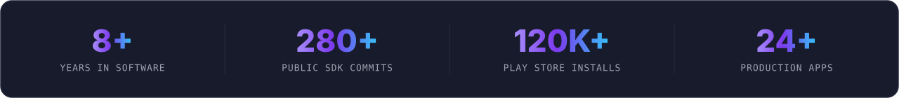
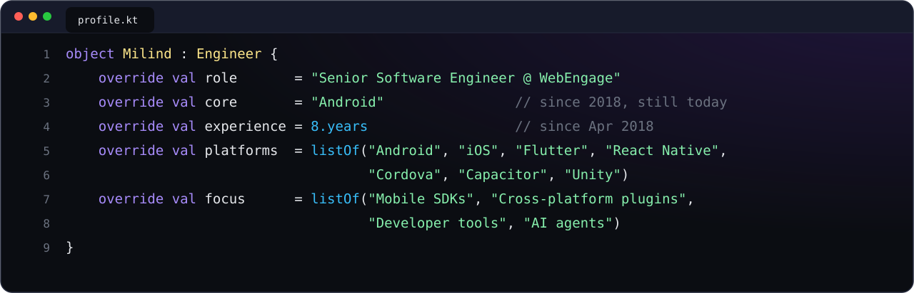
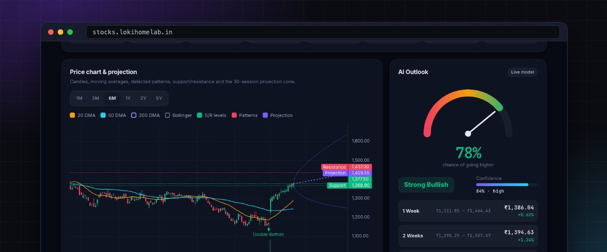
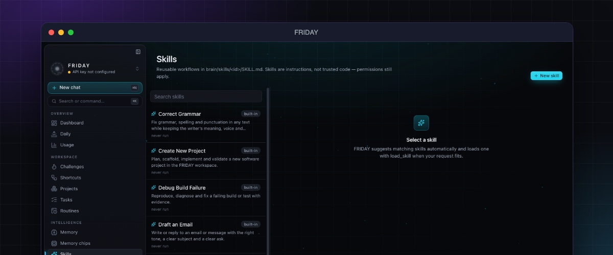
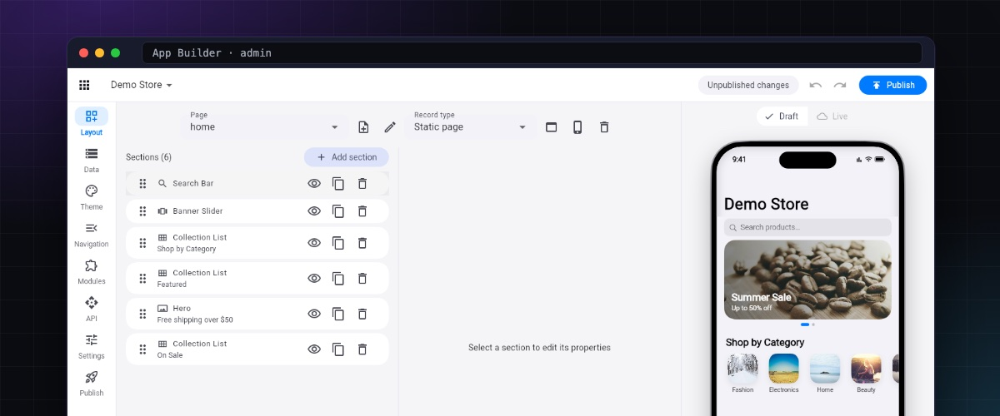
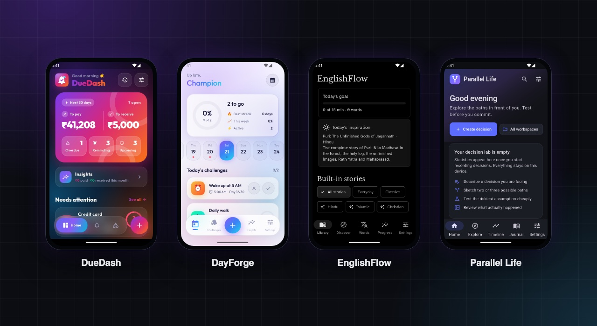
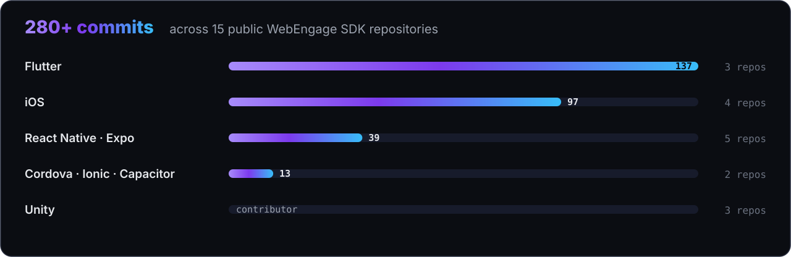
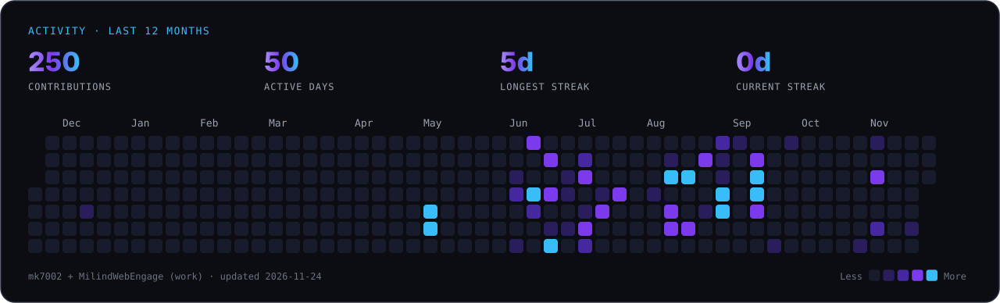

<!-- Assets are generated: scripts/build_assets.py (static) and scripts/update_stats.py (daily, via GitHub Actions). -->

<picture>
  <source media="(max-width: 600px)" srcset="https://raw.githubusercontent.com/mk7002/mk7002/main/assets/hero-mobile.svg" />
  
</picture>

  <a href="https://lokihomelab.in/"><b>lokihomelab.in</b></a> &nbsp;·&nbsp;
  <a href="https://www.linkedin.com/in/milindkeni">LinkedIn</a> &nbsp;·&nbsp;
  <a href="https://github.com/MilindWebEngage">Work GitHub</a> &nbsp;·&nbsp;
  Mumbai, India

<picture>
  <source media="(max-width: 600px)" srcset="https://raw.githubusercontent.com/mk7002/mk7002/main/assets/metrics-mobile.svg" />
  
</picture>

  

<picture>
  <source media="(max-width: 600px)" srcset="https://raw.githubusercontent.com/mk7002/mk7002/main/assets/section-intro-mobile.svg" />
  
</picture>

I'm an **Android developer** and senior software engineer with **8+ years** in mobile. Android has been my core platform since 2018 and still is today; around it I work on iOS and the cross-platform layers built on top of both.

At **WebEngage** I build the mobile SDKs and plugins that product teams integrate into their apps: Flutter, React Native, Expo, Cordova, Capacitor and Unity bridges on top of the native Android and iOS SDKs, plus the iOS push-notification extensions. I also build developer tools for testing and debugging those integrations. Before that I spent four years as an Android developer, shipping apps for clients across OTT, health, IoT, social and enterprise.

Outside work I build developer tools and offline-first apps. Lately I've been working on **AI agents and LLM integration**.

 

<picture>
  <source media="(max-width: 600px)" srcset="https://raw.githubusercontent.com/mk7002/mk7002/main/assets/intro-mobile.svg" />
  
</picture>

 

<picture>
  <source media="(max-width: 600px)" srcset="https://raw.githubusercontent.com/mk7002/mk7002/main/assets/section-stack-mobile.svg" />
  
</picture>

  

| Layer | Technologies |
|---|---|
| **Android** | `Kotlin` `Java` `Jetpack Compose` `Coroutines` `Room` `ML Kit` `LiteRT` |
| **iOS** | `Swift` `Objective-C` `Swift Package Manager` `CocoaPods` `Notification Service / Content extensions` |
| **Cross-platform** | `Flutter` `Dart` `React Native` `Expo` `Cordova` `Ionic` `Capacitor` `Unity` |
| **Messaging & cloud** | `Firebase` `FCM` `APNs` `Node.js` `Express` `PHP` `MySQL` |
| **AI & tooling** | `Claude API` `LLM tool use` `Electron` `Gradle` `ADB` `Git` |

<picture>
  <source media="(max-width: 600px)" srcset="https://raw.githubusercontent.com/mk7002/mk7002/main/assets/section-expertise-mobile.svg" />
  
</picture>

<table>
  <tr>
    <td width="50%" valign="top">
      <h4>Mobile SDK development</h4>
      SDKs and libraries that other developers integrate: public APIs, native Android and iOS implementations, sample apps and integration guides.
    </td>
    <td width="50%" valign="top">
      <h4>Cross-platform plugins &amp; bridges</h4>
      Flutter method channels, React Native native modules, Expo config plugins, Cordova/Capacitor plugins and Unity bridges on top of native SDKs.
    </td>
  </tr>
  <tr>
    <td width="50%" valign="top">
      <h4>Native Android &amp; iOS</h4>
      Kotlin, Java and Jetpack Compose on Android; Swift and Objective-C on iOS, including notification service and content extensions.
    </td>
    <td width="50%" valign="top">
      <h4>Push notifications &amp; engagement</h4>
      FCM and APNs delivery, rich push, notification inboxes and in-app personalization, across native and cross-platform apps.
    </td>
  </tr>
  <tr>
    <td width="50%" valign="top">
      <h4>Developer tools &amp; debugging</h4>
      Tools that shorten the debug loop: a push-notification tester, a mock API server and an APK pull/push desktop app.
    </td>
    <td width="50%" valign="top">
      <h4>AI agents &amp; LLM integration</h4>
      LLM-powered agents with schema-validated, permission-checked tools, plus reusable prompt libraries for AI-assisted development.
    </td>
  </tr>
</table>

<picture>
  <source media="(max-width: 600px)" srcset="https://raw.githubusercontent.com/mk7002/mk7002/main/assets/section-experience-mobile.svg" />
  
</picture>

<picture>
  <source media="(max-width: 600px)" srcset="https://raw.githubusercontent.com/mk7002/mk7002/main/assets/timeline-mobile.svg" />
  
</picture>

#### WebEngage · Senior Software Engineer · Aug 2022 – present
- **Android** is still my core platform here: native Android work and the Android side of every plugin bridge.
- Build the cross-platform SDKs and plugins customers use to integrate WebEngage: **Flutter, React Native, Expo, Cordova, Capacitor and Unity**.
- Work on the **native iOS SDK** and the iOS push extensions for rich notifications and notification service.
- Build developer tools for testing and debugging SDK integrations.
- 280+ commits across 15 public SDK repositories (listed under Open-source contributions below).

#### Image Online Pvt. Ltd. · Android Developer · Jan 2021 – Aug 2022
- Android apps for document scanning (PDF and PPT export) and two OTT video-on-demand platforms.

#### Inspeero Technologies · Android Developer · Apr 2018 – Jan 2021
- Shipped 14 client apps across health, IoT, social, enterprise, music and e-commerce.
- **Designed the whole architecture** of OrgSens, an enterprise team-review app, and **built CommandOp end to end**: a digital-signage app with kiosk mode, WebView and phone/TV support.
- Wrote **React Native ↔ Android bridges** for Samsung Health, location and in-app purchases, and built XMPP chat for MBolder.

<b>All earlier client apps (2018–2022)</b>

 

**Image Online Pvt. Ltd.**

| App | What it is |
|---|---|
| Scanning App | Scan, print and share any document as PDF or PPT |
| The Channel One | OTT video-on-demand platform for shows and movies |
| FilmyStations | Video-on-demand streaming platform |

**Inspeero Technologies**

| App | What it is | My role |
|---|---|---|
| Qajiq | Employee, attendance, work and salary management | Android development |
| JARMA | Health tracker: fever, periods, immunisation, doctors and reports | Built multiple UI screens and their features |
| Purelenses | B2B e-commerce where manufacturers list catalogs and retailers order | React Native |
| SELF | Rewards for reaching academic and fitness goals | RN ↔ Android bridge for Samsung Health |
| Glance | Dating app | RN ↔ Android bridges for location and in-app purchases |
| RemoteLogger | Library that collects app logs into a remote store | Library development |
| Canvia | Smart art frame that shows curated artworks | New features and bug fixes |
| Unsyned | Music discovery through contests where listeners vote | Music player UI, complex UI, deep linking |
| OrgSens | Team meetings, peer reviews by KPI and weekly surveys | Designed the whole architecture and data flow |
| CommandOp | Digital signage: pushes HTML content to registered devices | Built the whole app: kiosk mode, WebView, phone and TV |
| Picostone | Control home lights, fans and ACs from your phone (IoT) | Android development |
| MBolder | Social platform that matches you into small groups | Java and XMPP chat |
| iFix | Movie and TV streaming | Android development |
| BizQuiz | Kiosk-mode marketing app for Chase Bank business services | Android development |

<picture>
  <source media="(max-width: 600px)" srcset="https://raw.githubusercontent.com/mk7002/mk7002/main/assets/section-playstore-mobile.svg" />
  
</picture>

Apps I built and shipped to Google Play since 2024: **120K+ installs** in total.

<picture>
  <source media="(max-width: 600px)" srcset="https://raw.githubusercontent.com/mk7002/mk7002/main/assets/section-projects-mobile.svg" />
  
</picture>

### Notify Now
A push-notification playground for mobile developers. Send test pushes to a real device over **FCM HTTP v1** (service-account OAuth2) or **APNs** (.p8 token auth, sandbox and production), and save reusable payload templates. Keys stay on your device.

`Flutter Web` `FCM` `APNs` `JWT` &nbsp;·&nbsp; **[Live app ↗](https://push.lokihomelab.in/)** · [Repository](https://github.com/mk7002/PushNotification)

 

### Mocable
A personal mock REST API platform. Define endpoints with any status, headers and body, add latency, import mocks and inspect every request in a log, so frontend work never waits on the backend.

`Node.js` `Express` `Firebase` `PHP` `MySQL` &nbsp;·&nbsp; **[Live app ↗](https://mocable.lokihomelab.in/)** · [Repository](https://github.com/mk7002/mocable)

 

### StockSense India
An educational **stock-outlook dashboard for NSE and BSE**. It combines candlestick charts, moving averages, Bollinger bands, RSI and MACD, chart-pattern detection, support and resistance levels, and news-headline sentiment into a transparent, explainable outlook with a 30-session projection cone. It also saves predictions and checks them against real closing prices 5 and 10 sessions later, tracking calibration and which signals were right.

`JavaScript` `PHP` `Lightweight Charts` `Technical analysis` &nbsp;·&nbsp; **[Live app ↗](https://stocks.lokihomelab.in/)**

A learning project, not investment advice.

 

### APK Lab
A macOS desktop app to **pull and push APKs** between your Mac and connected Android devices. It detects `adb`, installs split APKs together with `adb install-multiple`, uninstalls by package name and exports logs.

`Flutter` `Dart` `macOS` `ADB` &nbsp;·&nbsp; **[Repository ↗](https://github.com/mk7002/apklab)**

 

### Android Network Connectivity
An Android library that exposes internet connectivity as an **RxJava** stream: subscribe once and react whenever the device goes on or offline. Published on JitPack.

`Java` `Android` `RxJava` &nbsp;·&nbsp; **[Repository ↗](https://github.com/mk7002/Android-Network-Connectivity)** · [JitPack](https://jitpack.io/#mk7002/Android-Network-Connectivity)

### FRIDAY · in development
A macOS desktop assistant that uses **Claude** as its reasoning engine. It does real engineering work (files, terminal, Git, project creation, build and test loops, debugging) through a tool layer where every action is **schema-validated, permission-checked and logged**, and risky actions wait for approval.

- **Memory** in readable Markdown, indexed with SQLite FTS5, plus portable *memory chips*: separate minds with their own personality, memory and skills.
- **Skills, Shortcuts and Routines**: reusable workflows (debug a failing build, plan my day…), one-click multi-step shortcuts with triggers, and reminders.
- **Daily standups and wrap-ups** written from real git commits, tasks and sessions; a task view showing each plan, tool output, file change and approval.

`Electron` `React` `TypeScript` `Claude API` `SQLite` &nbsp;·&nbsp; **[Repository ↗](https://github.com/mk7002/aia/tree/develop)**

### Prompt Library
A categorized, templated collection of AI prompts for coding, writing, image generation and productivity, with contribution rules. It can also serve as the prompt source for an **AI skill** (`SKILL.md`).

`Prompt engineering` `AI skills` &nbsp;·&nbsp; **[Repository ↗](https://github.com/mk7002/prompts)**

<picture>
  <source media="(max-width: 600px)" srcset="https://raw.githubusercontent.com/mk7002/mk7002/main/assets/section-sideprojects-mobile.svg" />
  
</picture>

Flutter apps I build in my own time: offline-first, no accounts, and polished UI. Source is coming to GitHub.

### App Builder
One Flutter codebase that can become **any kind of app**. Each published app renders itself from a JSON config, so its layout, data, theme, navigation and backend can change without shipping a new release. A web admin manages many apps, each with a section builder and a live phone preview. E-commerce is just one template; the runtime only knows collections, pages, sections, bindings and modules.

`Flutter` `Dart` `Server-driven UI` `Web admin`

 

<picture>
  <source media="(max-width: 600px)" srcset="https://raw.githubusercontent.com/mk7002/mk7002/main/assets/screens/side-apps-mobile.jpg" />
  
</picture>

### DueDash
Recurring **bill and IOU reminders**: track what you owe and what you're owed, with reminders that start before each due date, insights charts, a calendar, a home-screen widget, a biometric app lock and backup to your own Google Drive.

`Flutter` `Provider` `fl_chart` `local_auth` `Drive API`

### DayForge
**N-day habit challenges** with daily check-ins, reminders, streaks, charts, light and dark themes, and backup to Google Drive's private app folder.

`Flutter` `Notifications` `Charts` `Drive API`

### EnglishFlow
**Learn English by reading.** 27 built-in graded stories (A2–C1) with quizzes and glossaries, word lookup, vocabulary practice, daily goals and streaks. Frontend-only and offline-first.

`Flutter` `Offline-first` `Web` `Android`

### Parallel Life
A decision lab. Describe a decision, **sketch two or three paths**, test the riskiest assumption cheaply, then review what actually happened. Everything stays on the device.

`Flutter` `Drift` `SQLite` `Offline-first`

<b>Also in progress</b>: Face Gallery, Chess Trainer

 

| Project | What it is | Stack |
|---|---|---|
| **Face Gallery** | Offline Android gallery with on-device face grouping: ML Kit detection, 5-point alignment and MobileFaceNet embeddings. No `INTERNET` permission. | `Kotlin` `Compose` `ML Kit` `LiteRT` `Room` |
| **Chess Trainer** | Bots at levels 1–10 with a live coach (threats, the opponent's plan, hints and move grades), using a chess engine written from scratch | `Kotlin` `Compose` |

<picture>
  <source media="(max-width: 600px)" srcset="https://raw.githubusercontent.com/mk7002/mk7002/main/assets/section-opensource-mobile.svg" />
  
</picture>

Public SDK repositories I contribute to at **WebEngage**, used in production apps. Counts are my commits on each repo's default branch.

<picture>
  <source media="(max-width: 600px)" srcset="https://raw.githubusercontent.com/mk7002/mk7002/main/assets/sdk-mobile.svg" />
  
</picture>

| Platform | Repositories | Commits |
|---|---|---:|
| **Flutter** | [webengage-flutter](https://github.com/WebEngage/webengage-flutter) · [we-personalization-flutter](https://github.com/WebEngage/we-personalization-flutter) · [flutter-we-notification-inbox](https://github.com/WebEngage/flutter-we-notification-inbox) | `137` |
| **iOS** | [webengage-ios-sdk](https://github.com/WebEngage/webengage-ios-sdk) · [WEServiceExtension](https://github.com/WebEngage/WEServiceExtension) · [WEContentExtension](https://github.com/WebEngage/WEContentExtension) · [WebEngageAppEx](https://github.com/WebEngage/WebEngageAppEx) | `97` |
| **React Native · Expo** | [react-native-webengage](https://github.com/WebEngage/react-native-webengage) · [react-native-we-personalization](https://github.com/WebEngage/react-native-we-personalization) · [we-segment-react-native](https://github.com/WebEngage/we-segment-react-native) · [webengage-expo](https://github.com/WebEngage/webengage-expo) · [webengage-expo-push](https://github.com/WebEngage/webengage-expo-push) | `39` |
| **Cordova · Ionic · Capacitor** | [cordova-plugin](https://github.com/WebEngage/cordova-plugin) · [we-capacitor-plugins](https://github.com/WebEngage/we-capacitor-plugins) | `13` |
| **Unity** | [webengage-unity](https://github.com/WebEngage/webengage-unity) · [webengage-unity-android](https://github.com/WebEngage/webengage-unity-android) · [webengage-unity-ios](https://github.com/WebEngage/webengage-unity-ios) | contributor |

My own open-source library: [Android-Network-Connectivity](https://github.com/mk7002/Android-Network-Connectivity) (RxJava connectivity observer, on JitPack).

<picture>
  <source media="(max-width: 600px)" srcset="https://raw.githubusercontent.com/mk7002/mk7002/main/assets/section-exploring-mobile.svg" />
  
</picture>

- **Agentic developer tools.** In FRIDAY, an LLM plans the work while a deterministic tool layer validates, permission-checks and logs every action, and pauses risky ones for approval.
- **Prompts as maintained code.** My prompt library is versioned, templated and reviewable, and it doubles as the source for an AI skill.
- **AI-assisted engineering workflows.** I write development standards so coding agents produce consistent, reviewable changes across my projects.
- **On-device ML on mobile.** I run face detection and embeddings (ML Kit, MobileFaceNet on LiteRT) fully offline, tuned and checked against a labelled dataset.

<picture>
  <source media="(max-width: 600px)" srcset="https://raw.githubusercontent.com/mk7002/mk7002/main/assets/section-activity-mobile.svg" />
  
</picture>

<picture>
  <source media="(max-width: 600px)" srcset="https://raw.githubusercontent.com/mk7002/mk7002/main/assets/activity-mobile.svg" />
  
</picture>

Combines my personal account (mk7002) and my work account (<a href="https://github.com/MilindWebEngage">MilindWebEngage</a>). Rebuilt daily by a GitHub Action from GitHub's public contribution calendars.

 

<a href="https://www.linkedin.com/in/milindkeni"><picture>
  <source media="(max-width: 600px)" srcset="https://raw.githubusercontent.com/mk7002/mk7002/main/assets/contact-mobile.svg" />
  
</picture></a>

  
  
  

Android developer since 2018 · Senior Software Engineer at WebEngage · Mumbai, India

