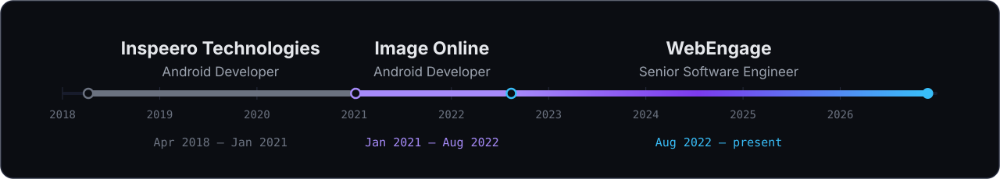
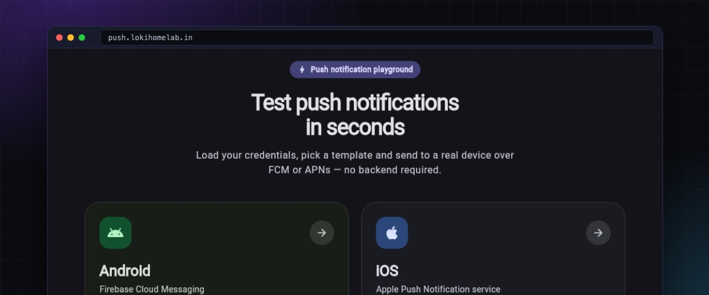
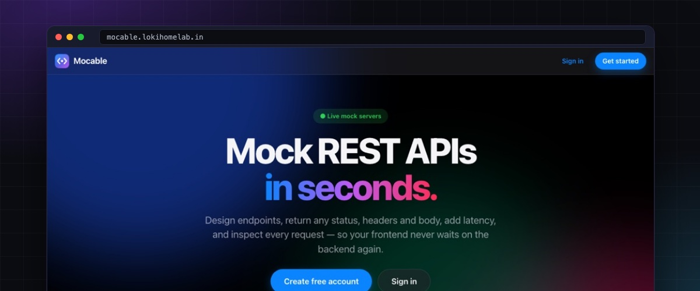
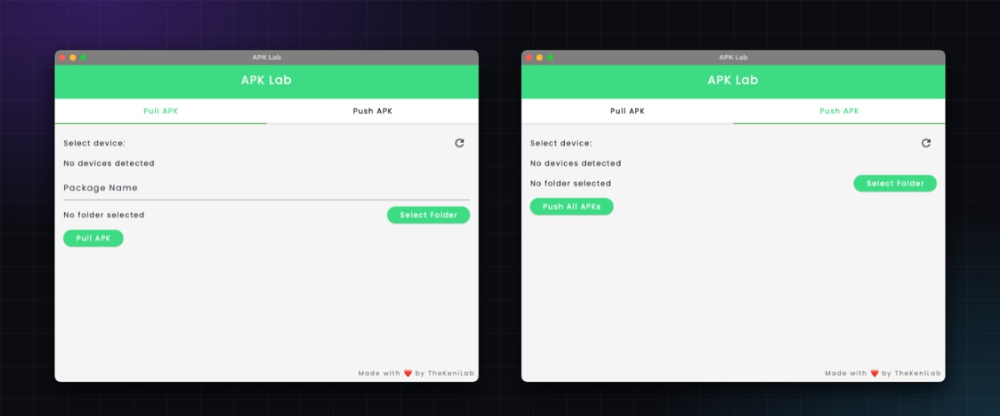
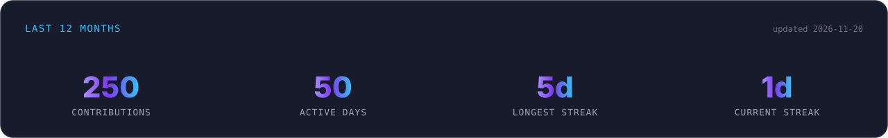
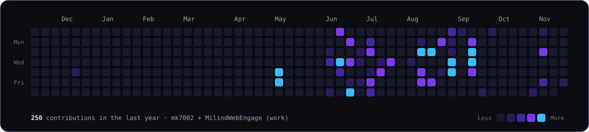

<!-- Assets are generated: scripts/build_assets.py (static) and scripts/update_stats.py (daily, via GitHub Actions). -->

<picture>
  <source media="(max-width: 600px)" srcset="https://raw.githubusercontent.com/mk7002/mk7002/main/assets/hero-mobile.svg" />
  
</picture>

<p align="center">
  <a href="https://www.linkedin.com/in/milindkeni">LinkedIn</a> &nbsp;·&nbsp;
  <a href="https://github.com/MilindWebEngage">Work GitHub</a> &nbsp;·&nbsp;
  Mumbai, India
</p>

<picture>
  <source media="(max-width: 600px)" srcset="https://raw.githubusercontent.com/mk7002/mk7002/main/assets/metrics-mobile.svg" />
  
</picture>

<br><br>

<picture>
  <source media="(max-width: 600px)" srcset="https://raw.githubusercontent.com/mk7002/mk7002/main/assets/section-intro-mobile.svg" />
  
</picture>

I'm a senior software engineer with **8+ years** of experience, almost all of it in mobile: native Android and iOS, and the cross-platform layers built on top of them.

At **WebEngage** I build the mobile SDKs and plugins that product teams integrate into their apps: Flutter, React Native, Expo, Cordova, Capacitor and Unity bridges on top of the native Android and iOS SDKs, plus the iOS push-notification extensions. I also build developer tools for testing and debugging those integrations. Before that I spent four years shipping Android apps for clients across OTT, health, IoT, social and enterprise.

Outside work I build developer tools and offline-first apps. Lately I've been working on **AI agents and LLM integration**.

```kotlin
object Milind : Engineer {
    override val role       = "Senior Software Engineer @ WebEngage"
    override val experience = 8.years                     // since 2018
    override val platforms  = listOf("Android", "iOS", "Flutter",
                                     "React Native", "Cordova", "Capacitor", "Unity")
    override val focus      = listOf("Mobile SDKs", "Cross-platform plugins",
                                     "Developer tools", "AI agents")
}
```

<picture>
  <source media="(max-width: 600px)" srcset="https://raw.githubusercontent.com/mk7002/mk7002/main/assets/section-stack-mobile.svg" />
  
</picture>

<p align="center">
  
</p>

| Layer | Technologies |
|---|---|
| **Android** | `Kotlin` `Java` `Jetpack Compose` `Coroutines` `Room` `ML Kit` `LiteRT` |
| **iOS** | `Swift` `Objective-C` `Swift Package Manager` `CocoaPods` `Notification Service / Content extensions` |
| **Cross-platform** | `Flutter` `Dart` `React Native` `Expo` `Cordova` `Ionic` `Capacitor` `Unity` |
| **Messaging & cloud** | `Firebase` `FCM` `APNs` `Node.js` `Express` `PHP` `MySQL` |
| **AI & tooling** | `Claude API` `LLM tool use` `Electron` `Gradle` `ADB` `Git` |

<picture>
  <source media="(max-width: 600px)" srcset="https://raw.githubusercontent.com/mk7002/mk7002/main/assets/section-expertise-mobile.svg" />
  
</picture>

<table>
  <tr>
    <td width="50%" valign="top">
      <h4>Mobile SDK development</h4>
      SDKs and libraries that other developers integrate: public APIs, native Android and iOS implementations, sample apps and integration guides.
    </td>
    <td width="50%" valign="top">
      <h4>Cross-platform plugins &amp; bridges</h4>
      Flutter method channels, React Native native modules, Expo config plugins, Cordova/Capacitor plugins and Unity bridges on top of native SDKs.
    </td>
  </tr>
  <tr>
    <td width="50%" valign="top">
      <h4>Native Android &amp; iOS</h4>
      Kotlin, Java and Jetpack Compose on Android; Swift and Objective-C on iOS, including notification service and content extensions.
    </td>
    <td width="50%" valign="top">
      <h4>Push notifications &amp; engagement</h4>
      FCM and APNs delivery, rich push, notification inboxes and in-app personalization, across native and cross-platform apps.
    </td>
  </tr>
  <tr>
    <td width="50%" valign="top">
      <h4>Developer tools &amp; debugging</h4>
      Tools that shorten the debug loop: a push-notification tester, a mock API server and an APK pull/push desktop app.
    </td>
    <td width="50%" valign="top">
      <h4>AI agents &amp; LLM integration</h4>
      LLM-powered agents with schema-validated, permission-checked tools, plus reusable prompt libraries for AI-assisted development.
    </td>
  </tr>
</table>

<picture>
  <source media="(max-width: 600px)" srcset="https://raw.githubusercontent.com/mk7002/mk7002/main/assets/section-experience-mobile.svg" />
  
</picture>

<picture>
  <source media="(max-width: 600px)" srcset="https://raw.githubusercontent.com/mk7002/mk7002/main/assets/timeline-mobile.svg" />
  
</picture>

#### WebEngage · Senior Software Engineer · Aug 2022 – present
- Build the cross-platform SDKs and plugins customers use to integrate WebEngage: **Flutter, React Native, Expo, Cordova, Capacitor and Unity**.
- Work on the **native iOS SDK** and the iOS push extensions for rich notifications and notification service.
- Build developer tools for testing and debugging SDK integrations.
- 280+ commits across 15 public SDK repositories (listed under Open-source contributions below).

#### Image Online Pvt. Ltd. · Android Developer · Jan 2021 – Aug 2022
- Android apps for document scanning (PDF and PPT export) and two OTT video-on-demand platforms.

#### Inspeero Technologies · Android Developer · Apr 2018 – Jan 2021
- Shipped 14 client apps across health, IoT, social, enterprise, music and e-commerce.
- **Designed the whole architecture** of OrgSens, an enterprise team-review app, and **built CommandOp end to end**: a digital-signage app with kiosk mode, WebView and phone/TV support.
- Wrote **React Native ↔ Android bridges** for Samsung Health, location and in-app purchases, and built XMPP chat for MBolder.

#### Shipped to Google Play · 2024 –

| App | What it is | Installs |
|---|---|---:|
| [**Kokan Vadhuvar**](https://play.google.com/store/apps/details?id=com.susha.KokanVadhuvar) | Matrimony platform for the Konkan community, with verified profiles | `100K+` |
| [**Maratha Sthal**](https://play.google.com/store/apps/details?id=com.susha.MarathaMatrimony) | Matrimony platform for the Maratha community | `10K+` |
| [**Buddhist Parinay**](https://play.google.com/store/apps/details?id=com.susha.BuddhistMatrimony) | Matrimony platform for the Buddhist community | `5K+` |
| [**Vadar Vadhuvar**](https://play.google.com/store/apps/details?id=com.susha.vadarvadhuvarflutter) | Matrimony platform for the Vadar community *(Flutter)* | `5K+` |
| [**SeQr Verify**](https://play.google.com/store/apps/details?id=com.seqrtechnology.verify) | Scan a product's code to check whether it's genuine or counterfeit | `1K+` |
| [**LUBE Corporation**](https://play.google.com/store/apps/details?id=com.lube) | Product verification and catalog app for a lubrication-equipment maker | `500+` |
| [**Susha Associate**](https://play.google.com/store/apps/details?id=com.susha.SushaAssociate) | Partner app where associates earn by referring matches | `10+` |

<sub>Install counts as shown on Google Play. Published by <a href="https://play.google.com/store/apps/dev?id=6660512038571678305">Susha Branding Solutions</a> and <a href="https://play.google.com/store/apps/developer?id=SeQr+Technology">SeQr Technology</a>.</sub>

<details>
<summary><b>All earlier client apps (2018–2022)</b></summary>

<br>

**Image Online Pvt. Ltd.**

| App | What it is |
|---|---|
| Scanning App | Scan, print and share any document as PDF or PPT |
| The Channel One | OTT video-on-demand platform for shows and movies |
| FilmyStations | Video-on-demand streaming platform |

**Inspeero Technologies**

| App | What it is | My role |
|---|---|---|
| Qajiq | Employee, attendance, work and salary management | Android development |
| JARMA | Health tracker: fever, periods, immunisation, doctors and reports | Built multiple UI screens and their features |
| Purelenses | B2B e-commerce where manufacturers list catalogs and retailers order | React Native |
| SELF | Rewards for reaching academic and fitness goals | RN ↔ Android bridge for Samsung Health |
| Glance | Dating app | RN ↔ Android bridges for location and in-app purchases |
| RemoteLogger | Library that collects app logs into a remote store | Library development |
| Canvia | Smart art frame that shows curated artworks | New features and bug fixes |
| Unsyned | Music discovery through contests where listeners vote | Music player UI, complex UI, deep linking |
| OrgSens | Team meetings, peer reviews by KPI and weekly surveys | Designed the whole architecture and data flow |
| CommandOp | Digital signage: pushes HTML content to registered devices | Built the whole app: kiosk mode, WebView, phone and TV |
| Picostone | Control home lights, fans and ACs from your phone (IoT) | Android development |
| MBolder | Social platform that matches you into small groups | Java and XMPP chat |
| iFix | Movie and TV streaming | Android development |
| BizQuiz | Kiosk-mode marketing app for Chase Bank business services | Android development |

</details>

<picture>
  <source media="(max-width: 600px)" srcset="https://raw.githubusercontent.com/mk7002/mk7002/main/assets/section-projects-mobile.svg" />
  
</picture>

<a href="https://push.lokihomelab.in/"></a>

### Notify Now
A push-notification playground for mobile developers. Send test pushes to a real device over **FCM HTTP v1** (service-account OAuth2) or **APNs** (.p8 token auth, sandbox and production), and save reusable payload templates. Keys stay on your device.

`Flutter Web` `FCM` `APNs` `JWT` &nbsp;·&nbsp; **[Live app ↗](https://push.lokihomelab.in/)** · [Repository](https://github.com/mk7002/PushNotification)

<br>

<a href="https://mocable.lokihomelab.in/"></a>

### Mocable
A personal mock REST API platform. Define endpoints with any status, headers and body, add latency, import mocks and inspect every request in a log, so frontend work never waits on the backend.

`Node.js` `Express` `Firebase` `PHP` `MySQL` &nbsp;·&nbsp; **[Live app ↗](https://mocable.lokihomelab.in/)** · [Repository](https://github.com/mk7002/mocable)

<br>

<a href="https://github.com/mk7002/apklab"></a>

### APK Lab
A macOS desktop app to **pull and push APKs** between your Mac and connected Android devices. It detects `adb`, installs split APKs together with `adb install-multiple`, uninstalls by package name and exports logs.

`Flutter` `Dart` `macOS` `ADB` &nbsp;·&nbsp; **[Repository ↗](https://github.com/mk7002/apklab)**

<br>

### Android Network Connectivity
An Android library that exposes internet connectivity as an **RxJava** stream: subscribe once and react whenever the device goes on or offline. Published on JitPack.

`Java` `Android` `RxJava` &nbsp;·&nbsp; **[Repository ↗](https://github.com/mk7002/Android-Network-Connectivity)** · [JitPack](https://jitpack.io/#mk7002/Android-Network-Connectivity)

### FRIDAY <sub>· in development</sub>
A macOS desktop assistant that uses **Claude** as its reasoning engine. It does real engineering work (files, terminal, Git, builds, debugging) through a tool layer where every action is **schema-validated, permission-checked and logged**, and risky actions wait for approval. Its memory is readable Markdown.

`Electron` `React` `TypeScript` `Claude API` &nbsp;·&nbsp; Source coming soon

### Prompt Library
A categorized, templated collection of AI prompts for coding, writing, image generation and productivity, with contribution rules. It can also serve as the prompt source for an **AI skill** (`SKILL.md`).

`Prompt engineering` `AI skills` &nbsp;·&nbsp; **[Repository ↗](https://github.com/mk7002/prompts)**

<details>
<summary><b>More projects</b>: Face Gallery, Chess Trainer, EnglishFlow, DueDash, DayForge, Parallel Life, App Builder (source coming to GitHub)</summary>

<br>

| Project | What it is | Stack |
|---|---|---|
| **Face Gallery** | Offline Android gallery with on-device face grouping: ML Kit detection, 5-point alignment and MobileFaceNet embeddings. No `INTERNET` permission. | `Kotlin` `Compose` `ML Kit` `LiteRT` `Room` |
| **Chess Trainer** | Bots at levels 1–10 with a live coach (threats, the opponent's plan, hints and move grades), using a chess engine written from scratch | `Kotlin` `Compose` |
| **EnglishFlow** | Learn English by reading: 27 graded stories, quizzes, word lookup, vocabulary practice and streaks. Offline-first. | `Flutter` |
| **DueDash** | Bill and IOU reminders with recurring cycles, insights, app lock, home widget and Drive backup | `Flutter` |
| **DayForge** | N-day habit challenges with reminders, charts and Drive backup | `Flutter` |
| **Parallel Life** | Explore decisions by sketching alternative paths, running small experiments and comparing scenarios | `Flutter` `Drift` |
| **App Builder** | One Flutter codebase that renders any app from a JSON config, plus a web admin with a live preview | `Flutter` |

</details>

<picture>
  <source media="(max-width: 600px)" srcset="https://raw.githubusercontent.com/mk7002/mk7002/main/assets/section-opensource-mobile.svg" />
  
</picture>

Public SDK repositories I contribute to at **WebEngage**, used in production apps. Counts are my commits on each repo's default branch.

| Platform | Repositories | Commits |
|---|---|---:|
| **Flutter** | [webengage-flutter](https://github.com/WebEngage/webengage-flutter) · [we-personalization-flutter](https://github.com/WebEngage/we-personalization-flutter) · [flutter-we-notification-inbox](https://github.com/WebEngage/flutter-we-notification-inbox) | `137` |
| **iOS** | [webengage-ios-sdk](https://github.com/WebEngage/webengage-ios-sdk) · [WEServiceExtension](https://github.com/WebEngage/WEServiceExtension) · [WEContentExtension](https://github.com/WebEngage/WEContentExtension) · [WebEngageAppEx](https://github.com/WebEngage/WebEngageAppEx) | `97` |
| **React Native · Expo** | [react-native-webengage](https://github.com/WebEngage/react-native-webengage) · [react-native-we-personalization](https://github.com/WebEngage/react-native-we-personalization) · [we-segment-react-native](https://github.com/WebEngage/we-segment-react-native) · [webengage-expo](https://github.com/WebEngage/webengage-expo) · [webengage-expo-push](https://github.com/WebEngage/webengage-expo-push) | `39` |
| **Cordova · Ionic · Capacitor** | [cordova-plugin](https://github.com/WebEngage/cordova-plugin) · [we-capacitor-plugins](https://github.com/WebEngage/we-capacitor-plugins) | `13` |
| **Unity** | [webengage-unity](https://github.com/WebEngage/webengage-unity) · [webengage-unity-android](https://github.com/WebEngage/webengage-unity-android) · [webengage-unity-ios](https://github.com/WebEngage/webengage-unity-ios) | — |

My own open-source library: [Android-Network-Connectivity](https://github.com/mk7002/Android-Network-Connectivity) (RxJava connectivity observer, on JitPack).

<picture>
  <source media="(max-width: 600px)" srcset="https://raw.githubusercontent.com/mk7002/mk7002/main/assets/section-exploring-mobile.svg" />
  
</picture>

- **Agentic developer tools.** In FRIDAY, an LLM plans the work while a deterministic tool layer validates, permission-checks and logs every action, and pauses risky ones for approval.
- **Prompts as maintained code.** My prompt library is versioned, templated and reviewable, and it doubles as the source for an AI skill.
- **AI-assisted engineering workflows.** I write development standards so coding agents produce consistent, reviewable changes across my projects.
- **On-device ML on mobile.** I run face detection and embeddings (ML Kit, MobileFaceNet on LiteRT) fully offline, tuned and checked against a labelled dataset.

<picture>
  <source media="(max-width: 600px)" srcset="https://raw.githubusercontent.com/mk7002/mk7002/main/assets/section-activity-mobile.svg" />
  
</picture>

<picture>
  <source media="(max-width: 600px)" srcset="https://raw.githubusercontent.com/mk7002/mk7002/main/assets/stats-mobile.svg" />
  
</picture>

<br>

<picture>
  <source media="(max-width: 600px)" srcset="https://raw.githubusercontent.com/mk7002/mk7002/main/assets/contributions-mobile.svg" />
  
</picture>

<sub>Combines my personal account (mk7002) and my work account (<a href="https://github.com/MilindWebEngage">MilindWebEngage</a>). Rebuilt daily by a GitHub Action from GitHub's public contribution calendars.</sub>

<picture>
  <source media="(max-width: 600px)" srcset="https://raw.githubusercontent.com/mk7002/mk7002/main/assets/section-contact-mobile.svg" />
  
</picture>

<p align="center">
  I'm happy to talk about <b>mobile SDKs</b>, <b>cross-platform engineering</b> and <b>developer tooling</b>.
  <br><br>
  <a href="https://www.linkedin.com/in/milindkeni"></a>
  <a href="https://github.com/MilindWebEngage"></a>
</p>
